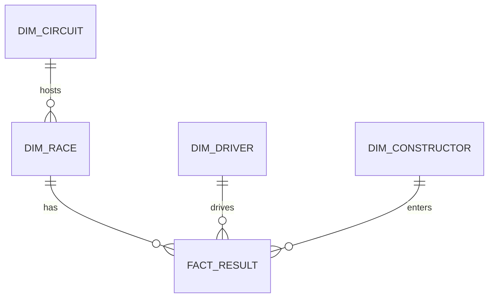

# Motorsport Race Intelligence — BI Developer portfolio project

An end-to-end, reproducible BI case study inspired by the Silverstone BI Developer role. It takes an openly licensed Formula 1 dataset through ingestion, dimensional modelling, quality gates, a local dashboard, and a Power BI/Fabric handoff.

**Honest scope:** this analyses public race performance, not Silverstone's private ticketing, CRM, ERP, finance, or marketing data. The Fabric folder is an implementation plan; the runnable pipeline and dashboard work locally without a Microsoft account.

## Why this project fits the role

| Job requirement | Evidence in this repository |
|---|---|
| SQL and dimensional modelling | `sql/schema.sql` and `sql/views.sql`: race-result fact with race, circuit, driver and constructor dimensions |
| Ingestion and ELT | `src/build.py`: pinned source release, deterministic extraction, transformations and CSV outputs |
| Data quality and governance | Duplicate, foreign-key, point-value and future-date checks; source version and SHA-256 manifest |
| Power BI semantic modelling | `powerbi/measures.dax` and report specification with relationships, measures and page design |
| Fabric platform thinking | `fabric/README.md`: Bronze/Silver/Gold pipeline, quality gate, monitoring and refresh design |
| Stakeholder communication | `sql/stakeholder_queries.sql`: three business questions with explicit metric definitions |

## Run locally

Python 3.10+ is required. The first build downloads the [F1DB v2026.16.1 SQLite release](https://github.com/f1db/f1db/releases/tag/v2026.16.1) (~16 MB zip). A built mart and CSVs are included, so you can open the dashboard without rebuilding.

```powershell
python -m venv .venv
.venv\Scripts\Activate.ps1
pip install -r requirements.txt
python src/build.py
streamlit run app.py
```

On macOS/Linux use `source .venv/bin/activate`. The dashboard URL is printed by Streamlit, normally `http://localhost:8501`.

To publish on GitHub, extract the supplied ZIP, open a terminal in `silverstone-motorsport-bi`, create an empty GitHub repository, then run `git init`, `git add .`, `git commit -m "Add motorsport BI portfolio project"`, `git branch -M main`, `git remote add origin <your-repository-url>`, and `git push -u origin main`. The included `.gitignore` keeps the 73 MB raw source database out of Git; the compact finished mart and CSVs are committed for immediate review.

To rebuild from a previously downloaded source file:

```powershell
python src/build.py --source path/to/f1db.db --start-year 2015 --end-year 2025
```

## Data model



`fact_result` has exactly one row per driver per completed Grand Prix race. Qualifying, sprint, practice and pit-stop event rows are excluded because they have different grains. The default years are 2015–2025, avoiding an incomplete 2026 season. `dim_race` is filtered to dates on or before the build date.

## Metric definitions

- **Race starts / driver results:** count of `fact_result` rows. These are recorded race results, including retirements.
- **Grand Prix races:** distinct race IDs.
- **Points:** source's official race points, including any applicable rules. Do not compare totals across eras without normalisation.
- **Podium:** finish position 1–3; **win:** position 1.
- **Retirement rate:** results with a non-null recorded retirement reason divided by driver results. This is a source-field proxy, not an independently adjudicated DNF rate.
- **Positions gained:** starting grid position minus finish position, calculated only when both exist.

## Data provenance and licence

Source: [F1DB](https://github.com/f1db/f1db), created by Marcel Overdijk and contributors. Data is licensed [CC BY 4.0](https://github.com/f1db/f1db/blob/main/LICENSE). This project uses release `v2026.16.1` and transforms its SQLite data into a 2015–2025 star schema. See `data/manifest.json` for the source URL, SHA-256 of the extracted database, build timestamp and quality results. The transformed data retains the F1DB attribution and licence. Project code is MIT licensed (see `LICENSE`).

Formula 1 and related marks belong to their respective owners. This is an independent portfolio demonstration and is not affiliated with Formula 1 or Silverstone.

## Quality and limitations

The build fails for duplicate `(race_id, driver_id)` keys, missing dimension relationships, null/negative points, future races, or an empty mart. It produces five CSV files for Power BI import and `data/motorsport_bi.sqlite` for the dashboard. This is a relatively small public dataset; a production pipeline would also need incremental loading, schema-drift alerts, access controls, secrets management and operational monitoring. No real customer or financial data is present.

## Suggested interview walkthrough

1. Explain the fact grain and why pit-stop events are separate from race results.
2. Show how the release is pinned and what the quality gate checks.
3. Filter the dashboard to Silverstone and explain the denominator of retirement rate.
4. Open `powerbi/measures.dax` and discuss filter context and relationships.
5. Explain how the local build would migrate into a Fabric Lakehouse, Pipeline and Power BI semantic model.

